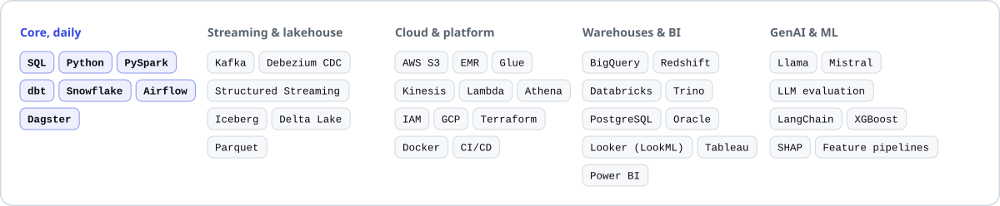

<a href="https://devanshi4.github.io">
  <picture><source media="(prefers-color-scheme: dark)" srcset="assets/header-dark.svg"></picture>
</a>

  <a href="https://devanshi4.github.io"><b>Portfolio</b></a> &nbsp;·&nbsp;
  <a href="https://www.linkedin.com/in/devanshi4/"><b>LinkedIn</b></a> &nbsp;·&nbsp;
  <a href="https://devanshi4.github.io/Devanshi_Pandya_Resume.pdf"><b>Resume (PDF)</b></a> &nbsp;·&nbsp;
  <a href="mailto:devanshipandya44@gmail.com"><b>devanshipandya44@gmail.com</b></a>

I'm a data engineer at Cloudify Technologies, embedded on client data teams for a **Fortune 500 telecom provider** and a **global payments platform**. Most of my favorite work starts with numbers that don't agree: I trace the problem to its source, fix it there, and add the check that stops it from coming back.

## Featured work

Each project runs from a raw source to a tested, queryable output. Click a card for the code, the architecture diagram and the trade-offs behind it.

  <a href="https://github.com/devanshi4/cell-site-entity-resolution"><picture><source media="(prefers-color-scheme: dark)" srcset="assets/card-entity-resolution-dark.svg"></picture></a>
  <a href="https://devanshi4.github.io/#spark-lab"><picture><source media="(prefers-color-scheme: dark)" srcset="assets/card-spark-lab-dark.svg"></picture></a>

  <a href="https://github.com/devanshi4/market-pulse"><picture><source media="(prefers-color-scheme: dark)" srcset="assets/card-market-pulse-dark.svg"></picture></a>
  <a href="https://github.com/devanshi4/ecommerce-lakehouse-aws"><picture><source media="(prefers-color-scheme: dark)" srcset="assets/card-lakehouse-dark.svg"></picture></a>

  <a href="https://github.com/devanshi4/weather-elt-snowflake"><picture><source media="(prefers-color-scheme: dark)" srcset="assets/card-weather-dark.svg"></picture></a>
  <a href="https://github.com/devanshi4/yelp-reviews-dbt"><picture><source media="(prefers-color-scheme: dark)" srcset="assets/card-yelp-dark.svg"></picture></a>

  <a href="https://github.com/devanshi4/text-to-sql-assistant"><picture><source media="(prefers-color-scheme: dark)" srcset="assets/card-text-to-sql-dark.svg"></picture></a>
  <a href="https://github.com/devanshi4/telecom-churn-prediction"><picture><source media="(prefers-color-scheme: dark)" srcset="assets/card-churn-dark.svg"></picture></a>

## Toolbox

<picture><source media="(prefers-color-scheme: dark)" srcset="assets/toolbox-dark.svg"></picture>

## Experience

| Role | Highlights |
|---|---|
| **Data Engineer**, Cloudify Technologies Jul 2024 – present · Remote | **Telecom:** local Llama 3.1 log classifier (~70 → ~20 categories, ~91% agreement) replacing a 400-line SQL rule; production dbt models on Snowflake; Oracle audit that found ~37K orphaned projects. **Payments:** data-skew handling for large PySpark ETL jobs; Kafka + Structured Streaming pipelines; fraud features with ML engineers. |
| **Data Engineer**, Brillio Sep 2023 – Jul 2024 · Tampa | SQL health monitoring across 10,000+ telecom sites; reconciliation reports across 5+ source systems. |
| **Data Analyst Intern**, Verizon May – Aug 2022 | Churn prediction with scikit-learn, customer segmentation (K-means, DBSCAN) and A/B test analysis. |
| **Business Data Analyst**, USC Auxiliary Services Feb 2022 – May 2023 · Los Angeles | Power BI dashboards and semantic models that cut weekly reporting time ~40%. |

M.S. Electrical &amp; Computer Engineering, University of Southern California · B.Tech., Gujarat Technological University

## Right now

- Building the **cell-site entity resolution** project module by module; Iceberg on S3 with EMR Serverless is next.
- Open to **data engineering roles** in New York or remote. Email or LinkedIn is the fastest way to reach me.
- Outside work I'm learning chess (and mostly losing). My site has a one-move checkmate puzzle you can try in the [Off the clock](https://devanshi4.github.io/#appendix) section.

